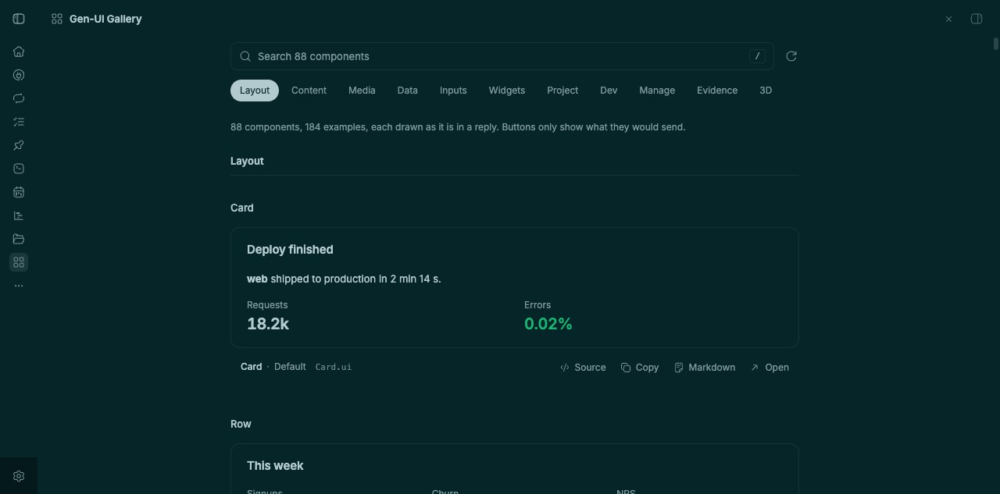
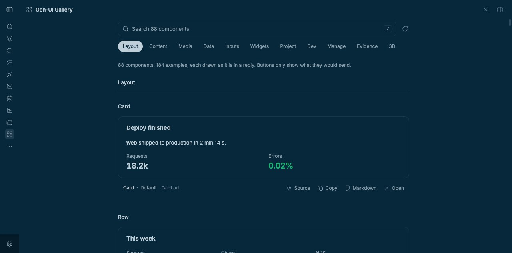
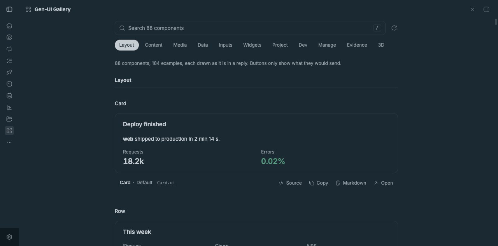
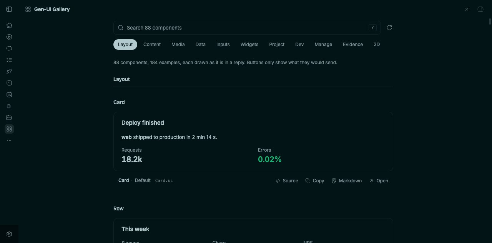
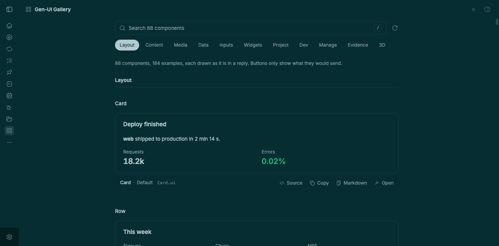
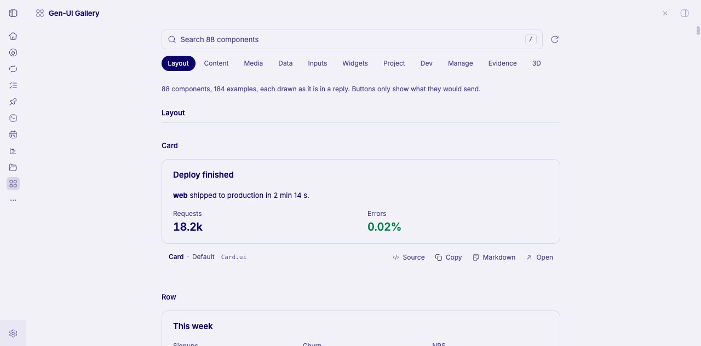
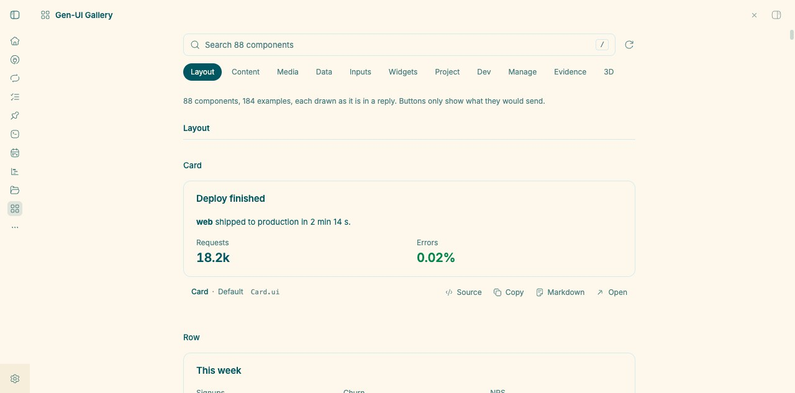
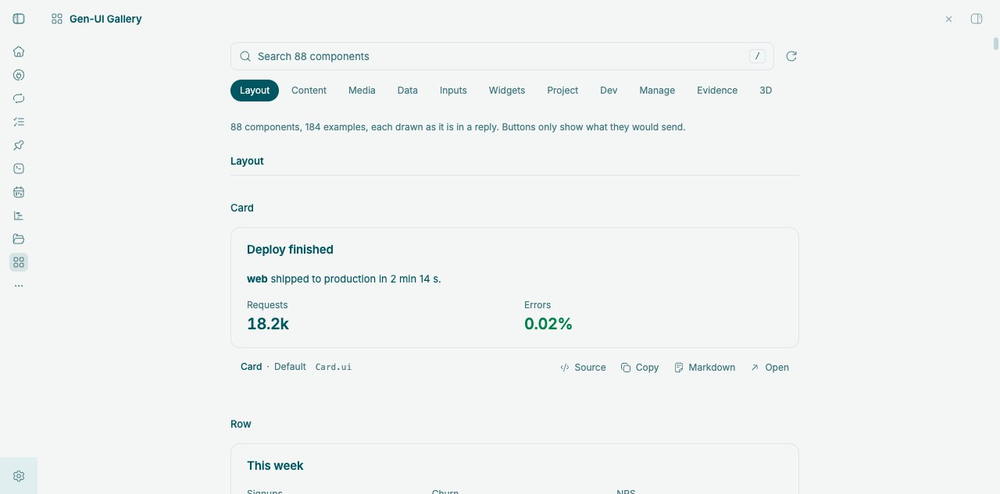

# Noctis Themes for bb

Eight [Noctis](https://github.com/liviuschera/noctis) color themes for
[bb](https://github.com/get-bb), packaged as a bb plugin. Five dark, three
light, each with a matching code, diff, and terminal palette.

## Screenshots

<table>
  <tr>
    <td align="center"><br><sub><b>noctis</b> · dark</sub></td>
    <td align="center"><br><sub><b>noctis-azureus</b> · dark</sub></td>
  </tr>
  <tr>
    <td align="center"><br><sub><b>noctis-minimus</b> · dark</sub></td>
    <td align="center"><br><sub><b>noctis-obscuro</b> · dark</sub></td>
  </tr>
  <tr>
    <td align="center"><br><sub><b>noctis-sereno</b> · dark</sub></td>
    <td align="center"><br><sub><b>noctis-lilac</b> · light</sub></td>
  </tr>
  <tr>
    <td align="center"><br><sub><b>noctis-lux</b> · light</sub></td>
    <td align="center"><br><sub><b>noctis-hibernus</b> · light</sub></td>
  </tr>
</table>

Previews are captured in bb's built-in Gen-UI Gallery on a clean workspace, so
no session or personal content is shown.

## Install

```sh
bb plugin install git:https://github.com/iamhenry/bb-noctis-theme.git@^0.1.0
bb theme set plugin:noctis-theme:noctis
```

Then pick any of the eight under **Settings → Appearance**, or by id:

| Theme | Id |
| --- | --- |
| Noctis | `plugin:noctis-theme:noctis` |
| Noctis Azureus | `plugin:noctis-theme:noctis-azureus` |
| Noctis Minimus | `plugin:noctis-theme:noctis-minimus` |
| Noctis Obscuro | `plugin:noctis-theme:noctis-obscuro` |
| Noctis Sereno | `plugin:noctis-theme:noctis-sereno` |
| Noctis Lilac | `plugin:noctis-theme:noctis-lilac` |
| Noctis Lux | `plugin:noctis-theme:noctis-lux` |
| Noctis Hibernus | `plugin:noctis-theme:noctis-hibernus` |

Update with `bb plugin update noctis-theme`.

## What you get

Each theme ships `theme.css` for the app palette and `pierre-dark.json` /
`pierre-light.json` for code, diffs, and file previews. They are tuned ports,
not straight palette dumps:

- **Flat frame** — the icon rail, sidebar, and window chrome share the canvas
  color instead of stacking a darker strip.
- **Neutral text tiers** — metadata, timestamps, and branch paths use a grey
  mixed from each theme's own ink rather than Noctis's blue chrome greys.
  Contrast stays at 4.5:1 or better for secondary text.
- **Softer separators** — borders and dividers are a 10% / 8% ink lift instead
  of the near-black window border.
- **One look per variant** — Noctis ships a single mode per theme, so each port
  keeps that palette in both light and dark mode.

Bordo, UVA, and Viola are not included.

## Development

```sh
npm install
bb plugin build .
bb plugin install . --yes    # local path install, loads server.ts directly
bb plugin dev .              # rebuild and reload on save
```

A theme-only plugin still needs the `server.ts` entry: bb only activates the
manifest's themes from a loaded plugin. See
[plugin authoring](https://github.com/get-bb/bb) for the manifest contract.

## License

MIT. The palette is Copyright (c) 2018 Liviu Schera; the bb port is
Copyright (c) 2026 iamhenry. See [LICENSE](LICENSE) and
[THIRD_PARTY_NOTICES.md](THIRD_PARTY_NOTICES.md).
